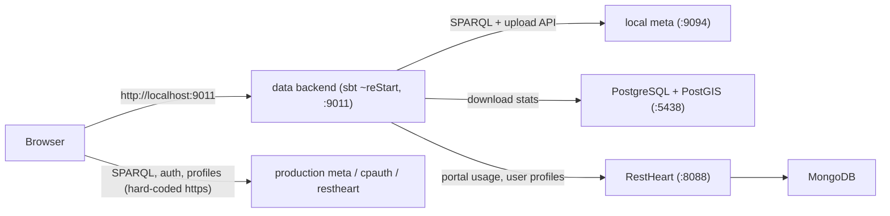

# Local development setup for `data`

**Part 1** walks you through getting the full `data` dev environment running (backend, frontend, PostgreSQL/PostGIS and RestHeart/MongoDB). It assumes the [meta](https://github.com/ICOS-Carbon-Portal/meta) service is **already running locally** on `http://127.0.0.1:9094/`.

**Part 2** lists where the "Information for developers" section of the main [README.md](README.md) is wrong or incomplete, plus other pitfalls.

---

# Part 1: Setup guide

## 1.1 Overview



> [!NOTE]
> The **browser-side** apps (portal and the others) don't talk to your local meta. `src/main/js/common/main/config.js` builds `https://<metaHost>/sparql` and `https://<authHost>/…`, and hard-codes `restheart.icos-cp.eu`. With the default `metaHost = meta.icos-cp.eu`, the portal searches **production metadata**. Only the **Scala backend** uses your local meta (for uploads, downloads, landing-page metadata and collections).

## 1.2 Prerequisites

| Tool | Version | Notes |
|---|---|---|
| JDK | **21** | CI uses Temurin 21. `-Xtarget:11`, so 11+ compiles, but stick to 21. |
| sbt | any launcher | The build pins `sbt.version=1.10.6` and the launcher downloads it. With an sbt **2.x** launcher, use `sbt --no-client` if the shell behaves oddly. |
| Node.js | **22 or 24 LTS** | Minimum is `^20.19 \|\| >=22.12` (Vite 8 in `portal`). **Not** the Node 8 the README says. Very new Node versions (25+) may break the older webpack/karma tooling. |
| Docker + Compose | recent | Runs PostgreSQL/PostGIS and RestHeart/MongoDB. |
| Network | `repo.icos-cp.eu` reachable | `.sbtopts` forces **all** dependency resolution through ICOS's repos (see [Part 2](#22-other-things-that-can-go-wrong)). |
| meta | running on `:9094` | Default `cpdata.meta.baseUrl = "http://127.0.0.1:9094/"`. |

## 1.3 Check ports and meta

```bash
# Ports data needs: 9011 (data), 5438 (Postgres), 8088 (RestHeart); 9094 should be meta
ss -ltnp | grep -E ':(9011|5438|8088|9094)\b'

# meta's SPARQL endpoint should answer
curl -s -H 'Accept: text/csv' --data-urlencode 'query=SELECT * WHERE { ?s ?p ?o } LIMIT 1' \
  http://127.0.0.1:9094/sparql
```

> [!TIP]
> If your meta setup **already** gives you a PostGIS on `5438` or a RestHeart on `8088`, reuse it. You only need to create the databases and roles from §1.4. Otherwise, the containers below will clash on those ports.

## 1.4 Start PostgreSQL/PostGIS and RestHeart/MongoDB

At startup the backend **refuses to bind its port** unless both of these succeed: the Postgres log-table init and the RestHeart DB/collection init ([Main.scala](src/main/scala/se/lu/nateko/cp/data/Main.scala#L139-L160)). Put the two files below in a folder **outside** the repo (for example `~/cpdata-dev/`).

`pg-init.sql`: the databases and roles the init script expects ([initLogTables.sql](src/main/resources/sql/logging/initLogTables.sql)):

```sql
CREATE ROLE reader LOGIN;
CREATE ROLE writer LOGIN;
CREATE DATABASE cplog;     -- ICOS
CREATE DATABASE siteslog;  -- SITES
CREATE DATABASE paullog;   -- ICOS Cities
```

`docker-compose.yml`:

```yaml
services:
  postgis:
    image: postgis/postgis:16-3.4
    ports: ["5438:5432"]                 # data expects 5438, not 5432
    environment:
      POSTGRES_HOST_AUTH_METHOD: trust   # data's default passwords are empty; local dev only!
    volumes:
      - ./pg-init.sql:/docker-entrypoint-initdb.d/pg-init.sql
      - pgdata:/var/lib/postgresql/data

  mongo:
    image: mongo:7
    volumes:
      - mongodata:/data/db

  restheart:
    image: softinstigate/restheart:8
    depends_on: [mongo]
    ports: ["8088:8080"]
    environment:
      # connect to the mongo container and expose ALL databases at the root
      # (data uses /db, /sitesdb, /pauldb as database paths)
      RHO: >-
        /mclient/connection-string->"mongodb://mongo";
        /mongo/mongo-mounts->[{"what":"*","where":"/"}]

volumes:
  pgdata:
  mongodata:
```

```bash
cd ~/cpdata-dev && docker compose up -d

# sanity checks
docker compose exec postgis psql -U postgres -c '\l' | grep -E 'cplog|siteslog|paullog'
curl -s -u admin:secret http://127.0.0.1:8088/ | head -c 300; echo
```

> [!NOTE]
> `pg-init.sql` only runs on the **first** start, while the `pgdata` volume is empty. If you change it later, run `docker compose down -v` to recreate the volume.

> [!WARNING]
> RestHeart 7/8 **requires authentication** (default user `admin` / `secret`). `data` supports Basic auth through optional `username` / `password` fields on each RestHeart DB entry, which is why they appear in the config below. RestHeart 8 and its configuration keys (`RHO`, `mongo-mounts`) differ from the older RestHeart that production historically ran. If the RestHeart init fails, check the `data` log for the failing request. As a fallback, set `restheart.base.skipInit = true` (see §1.8).

## 1.5 Create the root `application.conf`

The backend reads `./application.conf` from its **working directory** (the repo root when you use sbt). It's **layered on top of** the bundled [src/main/resources/application.conf](src/main/resources/application.conf), so keep it small and only override what you need ([CpdataConfig.scala](src/main/scala/se/lu/nateko/cp/data/CpdataConfig.scala#L155-L163)). This file is gitignored.

```hocon
cpdata {
	# sample NetCDF files that ship with the repo
	netcdf.folder = "./src/test/resources/"

	# meta (default shown; change if your meta runs elsewhere)
	meta.baseUrl = "http://127.0.0.1:9094/"

	# PostGIS from docker-compose (host/port/dbNames/users match the defaults)
	postgis {
		hostname = "127.0.0.1"
		port = 5438
	}

	# RestHeart 8 needs credentials
	restheart.base.db {
		ICOS       { uri = "http://127.0.0.1:8088/db",      username = "admin", password = "secret" }
		SITES      { uri = "http://127.0.0.1:8088/sitesdb", username = "admin", password = "secret" }
		ICOSCities { uri = "http://127.0.0.1:8088/pauldb",  username = "admin", password = "secret" }
	}
}

# Without this, every page on http://localhost:9011 returns
# 400 "Unexpected host localhost, cannot find corresponding ENVRI"
metacore.envriConfigs.ICOS.dataHost = "localhost"
```

> [!IMPORTANT]
> If you previously copied the **entire** bundled `application.conf` to the root (as the old README instructed), replace it with the snippet above. A full copy silently stops picking up upstream changes to the defaults.

## 1.6 Build the frontend and start the backend

```bash
cd /path/to/data
sbt
```

In the sbt shell:

```text
cpFrontendApps                 # lists: dygraph-light, map-graph, netcdf, portal, stats, dashboard
cpFrontend install common      # npm ci for the shared code
cpFrontend install portal      # npm ci; repeat for every app you'll work on (first time / after lockfile changes)
cpFrontend build portal        # starts a resident watcher in the background; NO "~" in front
~reStart                       # backend on http://localhost:9011, restarts on Scala/Twirl changes
```

- Start the frontend watcher **before** `~reStart`, because `~reStart` takes over the shell. Press Enter to leave watch mode.
- Only **one** frontend watcher runs at a time. Running `cpFrontend build stats` replaces the portal watcher.
- Built JS goes to `target/scala-3.3.4/classes/frontendapps/` and is served from there, so frontend changes show up after a browser reload without restarting the backend.
- If the frontend complains that `metacore.ts` is missing, run `cpFrontendDoJarImports`. It copies the generated file out of the `meta-core` jar.

## 1.7 Verify

| Check | Expected |
|---|---|
| sbt log | `Started data: ServerBinding(/127.0.0.1:9011)`. If it says `Could not start 'data' service`, the error above it names the Postgres or RestHeart step that failed. |
| `curl http://localhost:9011/buildInfo` | Build info text. This route doesn't depend on the ENVRI. |
| http://localhost:9011/portal/ | Portal loads and shows search results (from **production** meta, see §1.1). |
| http://localhost:9011/netcdf/ | NetCDF demo viewer listing the `.nc` files from `src/test/resources/`. |
| `docker compose exec postgis psql -U postgres -d cplog -c '\dt'` | Tables `downloads`, `dobjs_extended`, … |
| `curl -s -u admin:secret http://127.0.0.1:8088/db` | Database `db` exists, with collections `users`, `portaluse`. |

Testing authenticated endpoints such as uploads: browser login won't work on `localhost`, because CP auth cookies are scoped to `.icos-cp.eu`. Instead, copy your `cpauthToken` from your profile at https://cpauth.icos-cp.eu/ and send it explicitly. Tokens are verified against the public keys bundled in `cpauth-core`.

```bash
curl -v -H "Cookie: cpauthToken=<token>" -H "Transfer-Encoding: chunked" \
  --upload-file <file> http://localhost:9011/objects/<data object id>
```

Upload permissions and metadata are looked up in your **local** meta, so the metadata package has to be registered there first.

## 1.8 Lighter variant: no Docker

If you're only working on the frontend or on Scala code that doesn't touch download stats or user profiles, you can skip §1.4 entirely:

```hocon
cpdata {
	netcdf.folder = "./src/test/resources/"
	restheart.base.skipInit = true   # backend starts without RestHeart
	postgis.skipInit = true          # backend starts without Postgres (stats endpoints and download logging will error)
}
metacore.envriConfigs.ICOS.dataHost = "localhost"
```

## 1.9 Day-to-day

```text
# in sbt
cpFrontend stop          # stop the frontend watcher
reStop                   # stop the backend
```

```bash
docker compose stop      # keep data
docker compose down -v   # wipe Postgres/Mongo volumes
```

> [!CAUTION]
> `sbt clean` deletes `target/`, **including the built frontend**. Run `cpFrontend build <app>` again afterwards.

---

# Part 2: Where the README is wrong, and other pitfalls

## 2.1 Where the README is wrong or incomplete

| # | README says | What's actually true | Evidence |
|---|---|---|---|
| 1 | Install **Node.js 8.x** | Every app needs **Node ≥ 18**, and `portal` needs **≥ 20**. The Vite 8 / rolldown versions in `portal`'s lockfile require **`^20.19.0 \|\| >=22.12.0`**. Node 8 can't even read the lockfiles (lockfileVersion 3). | `src/main/js/*/package.json` → `engines` |
| 2 | Run `~cpFrontend build <app>` | `cpFrontend` is an sbt **command** with three subcommands: `install`, `build` and `stop`. `build` does **not** install dependencies, so you have to run **`cpFrontend install <app>`** (which runs `npm ci`) first. | Bytecode of `icoscp-sbt-frontend` 0.1.3 |
| 3 | The `~` prefix | `build` already starts a resident `webpack watch` / `vite build --watch` process. With `~` in front, sbt kills and restarts that watcher every time a source file changes. Only **one** frontend watcher runs at a time. | `build.sbt` `cpFrontendBuildCommand`, plugin `stopAndStart` |
| 4 | Running `npm run build` yourself is implied to be fine | It exits right away unless `SCALA_CLASS_DIR` is set, because sbt sets it to `target/scala-3.3.4/classes`. Build through sbt. | [buildConf.js](src/main/js/common/main/buildConf.js) |
| 5 | "Make a copy of `src/main/resources/application.conf`" | You don't need a full copy. The root `application.conf` is loaded **on top of** the bundled one (`parseFile(...).withFallback(defaultApplication)`). A full copy freezes every default, so upstream changes to the bundled config stop reaching you without any warning. `example.application.conf` already shows the override-only pattern, but the README doesn't mention it. | [CpdataConfig.scala](src/main/scala/se/lu/nateko/cp/data/CpdataConfig.scala#L155-L163) |
| 6 | Backend only needs the **meta** project running | At startup, the backend also **requires PostgreSQL+PostGIS** (port **5438**, not 5432, with databases and roles created in advance) and **RestHeart** (port 8088), unless you skip them with `skipInit`. `Main` only binds the port after `restHeart.init` and `initLogTables` both succeed. | [Main.scala](src/main/scala/se/lu/nateko/cp/data/Main.scala#L139-L160) |
| 7 | (not mentioned) | Opening `http://localhost:9011` returns **400 "Unexpected host localhost, cannot find corresponding ENVRI"**. The ENVRI is picked by an *exact* Host-header match against `data.icos-cp.eu`, `meta.icos-cp.eu`, etc. | `EnvriConfig.matchesHost` in meta-core, [UploadRouting.scala](src/main/scala/se/lu/nateko/cp/data/routes/UploadRouting.scala#L180-L185) |
| 8 | (not mentioned) | `sbt clean` deletes the **built frontend**, because the JS is written to `target/scala-3.3.4/classes/frontendapps/` and served from the classpath. | `buildConf.js`, `StaticRouting.scala` |
| 9 | (not mentioned) | Java version: CI uses **JDK 21** (Temurin). | `.github/workflows/scala.yml` |
| 10 | (not mentioned) | The browser apps always talk to **production** meta, cpauth and RestHeart (hard-coded `https://` URLs), even when the backend points at a local meta. | [config.js](src/main/js/common/main/config.js) |

## 2.2 Other things that can go wrong

- **Network / private repos.** `.sbtopts` sets `-Dsbt.override.build.repos=true` with `project/repositories`. All dependencies, including sbt itself and **Maven Central artifacts**, come only from `repo.icos-cp.eu` proxies, plus Unidata and a `raw.github.com` repo. If `repo.icos-cp.eu` is unreachable (VPN, firewall, outage), nothing resolves, and there is no fallback. An existing coursier cache (`~/.cache/coursier`) helps after the first successful build.
- **sbt 2.x launcher.** The build pins sbt 1.10.6, and a 2.x launcher downloads and runs that version. If the shell behaves oddly (2.x launchers prefer the thin client), use `sbt --no-client`.
- **Very new Node.** Versions that satisfy the engine ranges but are much newer than the tooling (for example Node 25/26) can break old webpack plugins or karma. If `npm ci` or a build fails in a strange way, switch to Node 22 or 24 LTS before you debug anything else.
- **Stray root `package-lock.json`.** It's an empty lockfile (v1). Don't run `npm install` in the repo root. Each app under `src/main/js/<app>` has its own lockfile.
- **Generated `metacore.ts` / `metacore.py`.** They're gitignored and copied out of the `meta-core` jar (`cpFrontendJarImports`). If they're missing, run `cpFrontendDoJarImports`.
- **Postgres expectations:**
  - All three databases (`cplog`, `siteslog`, `paullog`) must exist. The init script runs for every ENVRI listed in `postgis.dbNames`, and HOCON merging means you can't easily remove entries from your override.
  - Roles `reader` and `writer` must exist. The script runs `REVOKE … FROM reader` and fails if the role is missing.
  - The `postgis` extension must be installable.
  - The `postgres` admin connects with an **empty password** by default, so you need trust auth or a password override (`cpdata.postgis.admin.password`).
- **RestHeart expectations:** the client can send Basic auth (optional `username` / `password` per DB entry). It uses `PUT /<db>` to create databases and `aggrs` collection metadata for aggregations. RestHeart 7+ also exposes only the `restheart` database by default, so you need a `mongo-mounts` override to expose `/db`, `/sitesdb` and `/pauldb`.
- **Login won't work on localhost.** Auth cookies are scoped to `.icos-cp.eu` / `.fieldsites.se`, so you'll be anonymous in the browser. Use an explicit `Cookie: cpauthToken=…` header with curl (§1.7).
- **GeoIP and mail.** Download logging looks up IPs at `https://geoip.icos-cp.eu`, and errors trigger emails through the configured SMTP account. Locally, with an empty mail password, those emails just fail and get logged.
- **Windows** isn't supported for frontend builds (the plugin shells out to `bash -c` and kills Unix process trees).
- **Tests on Apple Silicon/ARM Linux.** The JavaFX test deps use the classifiers `linux`/`mac`/`win`, which are x86_64 builds.

## 2.3 Not verified yet

- The RestHeart 8 docker setup (`RHO` keys, `mongo-mounts` override, and whether data's aggregation definitions are accepted by RestHeart 8).
- Starting the backend with `skipInit = true` and no Postgres at all. The DBCP pools should connect lazily.
- Side effects of `dataHost = "localhost"` beyond absolute links in the HTML templates.
